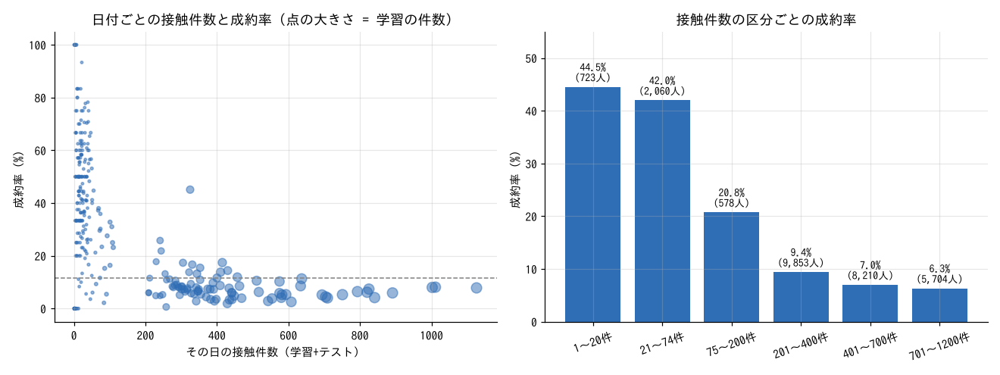

# 銀行の顧客ターゲティング（SIGNATE）

銀行の顧客属性と過去キャンペーンの接触情報から、今回のキャンペーンで定期預金の口座を開設したか（`y`）を予測する。評価は AUC。

- 学習 27,128 行（陽性率 11.7%）、予測 18,083 行、説明変数 16
- 元データは UCI Bank Marketing（2008〜2010年のポルトガルの銀行の電話営業）

## 結果

| | CV AUC（層化5分割） |
|---|---|
| LightGBM（元の特徴量のみ） | 0.93519 |
| + 簡単な追加特徴量（月の数値、`pdays=-1` フラグ、log 変換など） | 0.93723 |
| + 日付ごとの集計（件数、携帯比率、過去接触ありの比率など） | 0.94051 |
| LightGBM の設定調整（3シード平均） | 0.94137 |
| CatBoost（同じ特徴量、3シード平均） | 0.94132 |
| **最終: LightGBM 2種 + CatBoost 2種の順位平均** | **0.94196** |

提出ファイル: `submit_blend4.csv`（`exp/final.py` で作成。CSV はコミットしていない）

## 効いたこと

1. **日付（月＋日）ごとの件数**: 学習とテストを合わせて数える（目的変数は使わない）。データに年がないが、件数の多い日は初期の大量架電で成約率が低く（6〜8%）、件数が74以下の日は成約率 43%。年代の代わりになる
2. **日付ごとの集計**: その日の携帯電話の比率、連絡手段不明の比率、過去に接触した客の比率、通話時間・接触回数の平均、日付内での通話時間の順位
3. **性質の違うモデル（LightGBM・CatBoost）の順位平均**（+0.0006）



データの傾向: 成約を左右するのは通話時間（10分超で 44〜60%）、前回キャンペーンの結果（前回成約なら 64.8%）、時期（5月は 6.8%、3・9・10・12月は 44〜51%）。年齢では 25歳以下と 61歳以上、職業では学生・退職者が高い。

詳しい経緯は [`exp/experiments.md`](exp/experiments.md)（数値は `exp/experiments.csv`）、データの傾向は [`report.md`](report.md)（画像入りで単体で開ける [`report.html`](report.html) もある）。

## フォルダ構成

| パス | 内容 |
|---|---|
| `data/` | コンペのデータを置く（コミットしない）。`train.csv` `test.csv` `submit_sample.csv` |
| `report.md` / `report.html` / `figs/` / `insights.md` | 初期分析のレポート（データの傾向、考察、ベースライン） |
| `exp/lib.py` | 共通部品（読み込み、特徴量、層化5分割CV、LightGBM・CatBoost） |
| `exp/r01_baseline.py` | 基準モデル |
| `exp/r02_date_count.py` | 日付ごとの集計特徴量 |
| `exp/r03_models.py` | モデルの設定違い（予測を `exp/preds/` に保存） |
| `exp/blend.py` | 保存した予測の組み合わせを評価 |
| `exp/final.py` | 提出ファイルの作成 |
| `exp/experiments.md` / `.csv` | 全実験の記録（狙い・結果・判断）と CV AUC |

## 再現手順

```bash
pip install pandas numpy scipy scikit-learn lightgbm catboost
# data/ にコンペのファイルを置いてから
cd exp
python3 r03_models.py      # LightGBM 3種・CatBoost 2種（CPU 4コアで十数分）
python3 final.py           # → ../submit_blend4.csv
```

レポート（`report.md`）は、リポジトリ直下の `tools/eda_baseline.py` で作成した:

```bash
python3 ../../tools/eda_baseline.py run --train data/train.csv --test data/test.csv \
  --target y --id id --metric auc --out . --title "銀行の顧客ターゲティング"
python3 ../../tools/eda_baseline.py render --out .   # insights.md を反映
```
