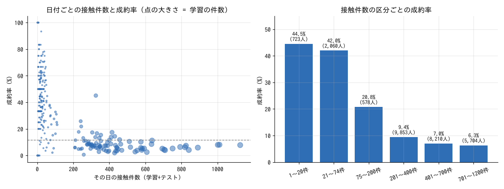

### 結論（3行）
- 口座を開設するかは、**通話時間（`duration`）・前回キャンペーンの結果（`poutcome`）・いつ電話したか（月・日）** でほぼ決まる。職業・学歴などの属性の影響は小さい。
- **最終モデルは LightGBM 2種と CatBoost 2種の順位平均で、交差検証の AUC 0.9420**。最初の LightGBM（元の16列のみ）は 0.9352。提出ファイルは `submit_blend4.csv`。
- 一番効いたのは **「その日に何人へ電話したか」（日付ごとの件数）**。データに年はないが、件数がその日の「時期」を表している。全実験の記録は `exp/experiments.md` と `exp/experiments.csv`。

### 検証方法
- 学習データを、成約の割合をそろえて5つに分け（層化5分割）、4つで学習して残り1つを予測することを5回くり返す。5回分の予測をまとめて AUC を計算する。
- train と test は同じ分布（見分けるモデルの AUC 0.501。月・日も同じ日付がほぼそろっている）なので、ランダムに分ける検証で本番の評価に近いと考えた。
- 乱数による差を減らすため、最終候補は分け方・seed を3通り変えて平均した。

### 実験のまとめ（スコアの推移）
| 段階 | CV AUC | 主な変更 |
|---|---|---|
| LightGBM、元の16列のみ | 0.93519 | 最初の基準 |
| ＋簡単な追加特徴量 | 0.93723 | 月の数値化、通し日（月×31＋日）、`pdays=-1`（過去の接触なし）フラグ、通話時間の log、通話時間 ÷ 接触回数、残高の log |
| ＋日付ごとの件数 | 0.93892 | 同じ月・日に何人へ電話したか（学習＋テストを合わせて数える） |
| ＋日付ごとの平均・比率 | 0.93953 | その日の携帯電話の比率、連絡手段不明の比率、過去に接触した客の比率、通話時間・年齢・接触回数の平均、月ごとの件数 |
| ＋日付の中での順位など | 0.94051 | その日の中での通話時間・接触回数の順位、日付×連絡手段の件数、同じ属性の客の件数 |
| LightGBM の設定を調整（3 seed） | 0.94137 | 列を半分ずつ使う、正則化を強める |
| CatBoost（同じ特徴量、3 seed） | 0.94132 | 単体では LightGBM とほぼ同じ |
| **最終: LightGBM 2種＋CatBoost 2種の順位平均** | **0.94196** | 間違え方の違うモデルを混ぜる |

### 一番効いたこと: 日付ごとの件数

- 元データ（UCI Bank Marketing）は 2008年5月〜2010年11月の電話営業の記録。このコンペのデータには「年」がない。
- **件数が多い日（200件超）は成約率 6〜9%、少ない日（74件以下）は 42〜45%**。件数が多いのは 2008年の大量架電の時期、少ないのは後の時期（相手を絞って電話した、または金利などの環境が違う）と考えられる。件数が年の代わりになっている。
- 月の成約率が 3・9・10・12月だけ 44〜51% と高いのも同じ理由で、これらの月は件数自体が少ない（130〜439人）。
- 目的変数は使っていないので、テストにもそのまま使える。最終モデルの重要度でも、通話時間（17%）に次いで2位（11%）。

### 見えた傾向
| 要素 | 傾向 |
|---|---|
| 全体 | 成約率 **11.7%**（27,128人中 3,174人） |
| 通話時間 | 1分以下 0.2%、2〜3分 5.8%、5〜10分 19.1%、**10分超で 44〜60%**。最も強い。ただし通話が終わるまで分からない値なので、実務で「電話する前に」相手を選ぶ用途には使えない（コンペでは説明変数として与えられている） |
| 前回の結果 | 前回成約（`success`）した客は **64.8%**。前回失敗 13.2%、前回接触なし 9.2% |
| 連絡手段 | 携帯 15.0%、固定電話 13.6%、**不明 4.0%**（不明は初期の時期に多い） |
| 月 | 5月が最多（8,317人）で **6.8%** と最低。3・9・10・12月は 44〜51% |
| 年齢 | 25歳以下 24.2%、**61歳以上 42.1%**、30〜60歳は 9〜10%。職業でも学生 29.8%、退職者 22.4% が高い |
| 住宅ローン・個人ローン | ローンがある人は低い（住宅ローンあり 7.7% / なし 16.8%、個人ローンあり 6.9% / なし 12.6%） |
| 今回の接触回数 | 1回目 14.8%、6〜10回 6.6%、11回以上 3.8%。何度もかけても成約しにくい |
| 残高 | 0以下 6.9%、2,000〜5,000 17.6% |

- train と test の違いはほぼない（見分けるモデルの AUC 0.501、テストだけにある日付は 318日中 9日）。
