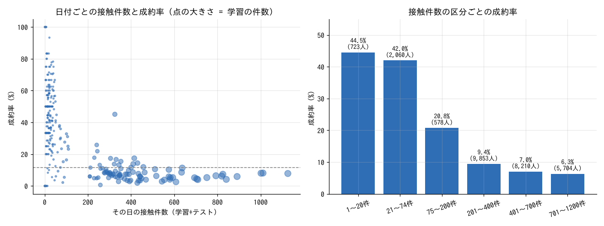
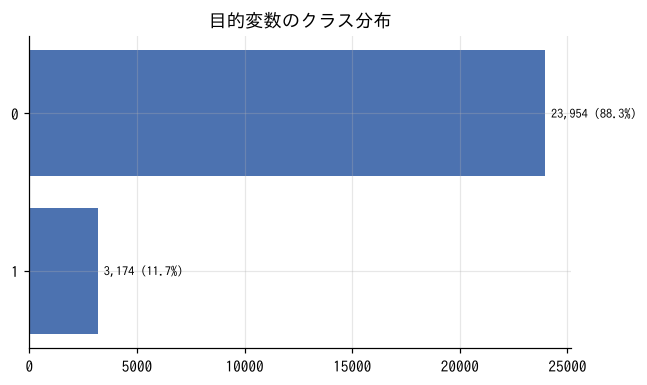
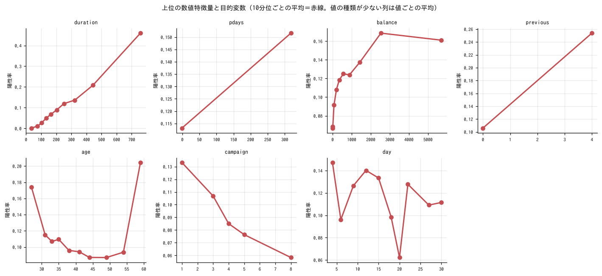
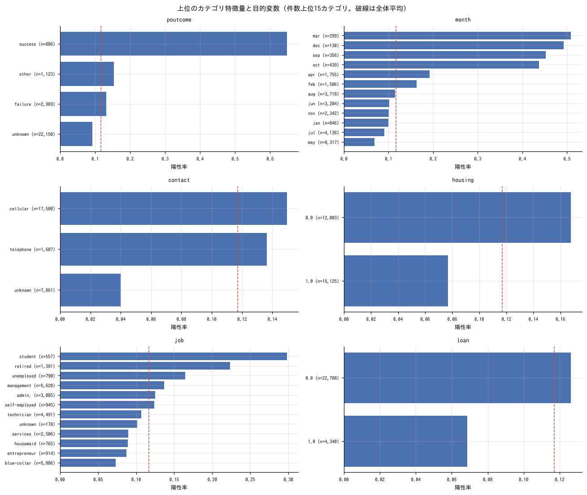
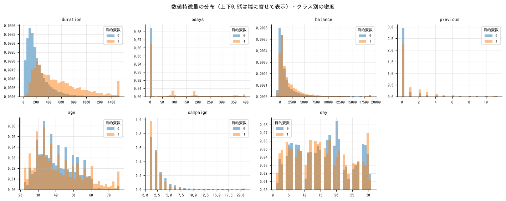
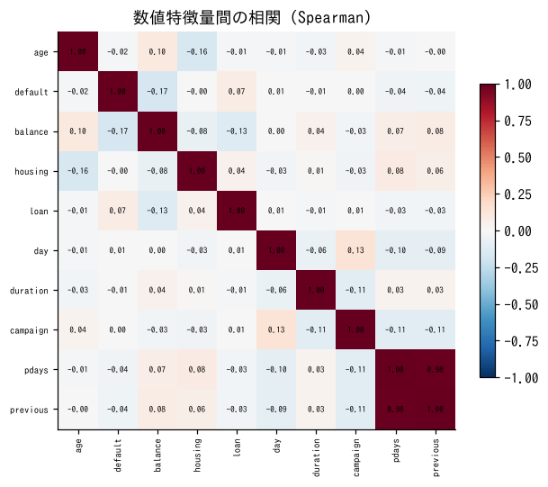
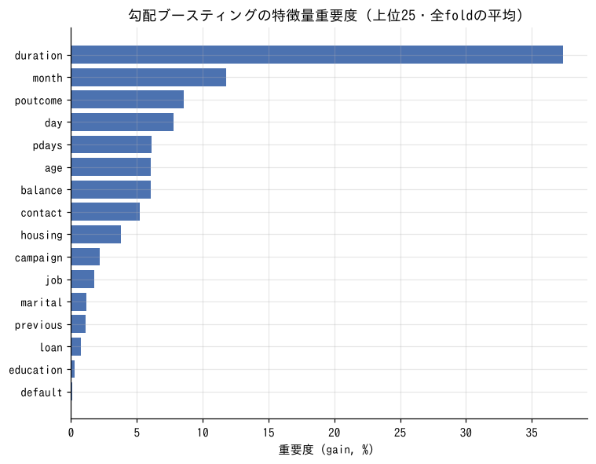
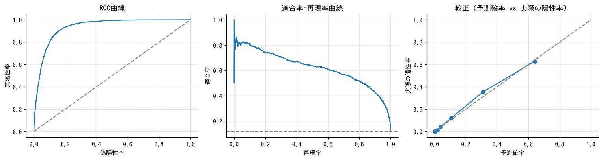

# 初期分析レポート: 銀行の顧客ターゲティング

- 実行日: 2026-11-08　／　データ: `train.csv`（27,128行 × 18列）　／　テスト: `test.csv`
- 課題: 顧客属性と過去キャンペーンの接触情報から、定期預金の口座開設の有無を予測する
- 目的変数: `y`（2値分類、陽性クラス = `1`）　／　主指標: **auc**
- 分析対象: 27,128行、特徴量 16列（ID 1列は除外）

## 0. まとめと考察

### 結論（3行）
- 口座を開設するかは、**通話時間（`duration`）・前回キャンペーンの結果（`poutcome`）・いつ電話したか（月・日）** でほぼ決まる。職業・学歴などの属性の影響は小さい。
- **最終モデルは LightGBM 2種と CatBoost 2種の順位平均で、交差検証の AUC 0.9420**。最初の LightGBM（元の16列のみ）は 0.9352。提出ファイルは `submit_blend4.csv`。
- 一番効いたのは **「その日に何人へ電話したか」（日付ごとの件数）**。データに年はないが、件数がその日の「時期」を表している。全実験の記録は `exp/experiments.md` と `exp/experiments.csv`。

### 検証方法
- 学習データを、成約の割合をそろえて5つに分け（層化5分割）、4つで学習して残り1つを予測することを5回くり返す。5回分の予測をまとめて AUC を計算する。
- train と test は同じ分布（見分けるモデルの AUC 0.501。月・日も同じ日付がほぼそろっている）なので、ランダムに分ける検証で本番の評価に近いと考えた。
- 乱数による差を減らすため、最終候補は分け方・seed を3通り変えて平均した。

### 実験のまとめ（スコアの推移）
| 段階 | CV AUC | 主な変更 |
|---|---|---|
| LightGBM、元の16列のみ | 0.93519 | 最初の基準 |
| ＋簡単な追加特徴量 | 0.93723 | 月の数値化、通し日（月×31＋日）、`pdays=-1`（過去の接触なし）フラグ、通話時間の log、通話時間 ÷ 接触回数、残高の log |
| ＋日付ごとの件数 | 0.93892 | 同じ月・日に何人へ電話したか（学習＋テストを合わせて数える） |
| ＋日付ごとの平均・比率 | 0.93953 | その日の携帯電話の比率、連絡手段不明の比率、過去に接触した客の比率、通話時間・年齢・接触回数の平均、月ごとの件数 |
| ＋日付の中での順位など | 0.94051 | その日の中での通話時間・接触回数の順位、日付×連絡手段の件数、同じ属性の客の件数 |
| LightGBM の設定を調整（3 seed） | 0.94137 | 列を半分ずつ使う、正則化を強める |
| CatBoost（同じ特徴量、3 seed） | 0.94132 | 単体では LightGBM とほぼ同じ |
| **最終: LightGBM 2種＋CatBoost 2種の順位平均** | **0.94196** | 間違え方の違うモデルを混ぜる |

### 一番効いたこと: 日付ごとの件数

- 元データ（UCI Bank Marketing）は 2008年5月〜2010年11月の電話営業の記録。このコンペのデータには「年」がない。
- **件数が多い日（200件超）は成約率 6〜9%、少ない日（74件以下）は 42〜45%**。件数が多いのは 2008年の大量架電の時期、少ないのは後の時期（相手を絞って電話した、または金利などの環境が違う）と考えられる。件数が年の代わりになっている。
- 月の成約率が 3・9・10・12月だけ 44〜51% と高いのも同じ理由で、これらの月は件数自体が少ない（130〜439人）。
- 目的変数は使っていないので、テストにもそのまま使える。最終モデルの重要度でも、通話時間（17%）に次いで2位（11%）。

### 見えた傾向
| 要素 | 傾向 |
|---|---|
| 全体 | 成約率 **11.7%**（27,128人中 3,174人） |
| 通話時間 | 1分以下 0.2%、2〜3分 5.8%、5〜10分 19.1%、**10分超で 44〜60%**。最も強い。ただし通話が終わるまで分からない値なので、実務で「電話する前に」相手を選ぶ用途には使えない（コンペでは説明変数として与えられている） |
| 前回の結果 | 前回成約（`success`）した客は **64.8%**。前回失敗 13.2%、前回接触なし 9.2% |
| 連絡手段 | 携帯 15.0%、固定電話 13.6%、**不明 4.0%**（不明は初期の時期に多い） |
| 月 | 5月が最多（8,317人）で **6.8%** と最低。3・9・10・12月は 44〜51% |
| 年齢 | 25歳以下 24.2%、**61歳以上 42.1%**、30〜60歳は 9〜10%。職業でも学生 29.8%、退職者 22.4% が高い |
| 住宅ローン・個人ローン | ローンがある人は低い（住宅ローンあり 7.7% / なし 16.8%、個人ローンあり 6.9% / なし 12.6%） |
| 今回の接触回数 | 1回目 14.8%、6〜10回 6.6%、11回以上 3.8%。何度もかけても成約しにくい |
| 残高 | 0以下 6.9%、2,000〜5,000 17.6% |

- train と test の違いはほぼない（見分けるモデルの AUC 0.501、テストだけにある日付は 318日中 9日）。

## 1. データクレンジングの記録

| 処理 | 内容 |
|---|---|
| 読み込み | 文字コード utf-8-sig、区切り文字 `,`、27,128行 × 18列（全列を文字列として読み、型は後で推定） |
| `default` の型変換（→bool） | ['no', 'yes'] を 0/1 に変換 |
| `housing` の型変換（→bool） | ['no', 'yes'] を 0/1 に変換 |
| `loan` の型変換（→bool） | ['no', 'yes'] を 0/1 に変換 |
| ID列と判断して特徴量から除外 | id（--id で明示指定も可） |
| （要確認）`duration` の値 | 極端な値が 14件（例: 2,653, 3,094, 4,918）。置換はしていません |
| （要確認）`campaign` の値 | 極端な値が 104件（例: 37, 25, 30）。置換はしていません |

## 2. 目的変数

| クラス | 件数 | 割合 |
|---|---|---|
| 0 | 23,954 | 88.3% |
| 1 | 3,174 | 11.7% |

- 多数クラス / 少数クラス = 7.5 倍

## 3. 列ごとのプロファイル

### 数値の列

| 列 | 種類 | 役割 | 欠損率 | ユニーク数 | 平均 | 標準偏差 | 最小 | 中央値 | 最大 | 歪度 | ゼロ率 | 外れ値率(IQR1.5) | 負の値 |
|---|---|---|---|---|---|---|---|---|---|---|---|---|---|
| id | numeric | ID（学習に使わない） | 0.0% | 27,128 | 13,564.5 | 7,831.323 | 1 | 13,564.5 | 27,128 | 0 | 0.0% | 0.0% | 0 |
| age | numeric | 特徴量 | 0.0% | 77 | 40.951 | 10.609 | 18 | 39 | 95 | 0.672 | 0.0% | 1.0% | 0 |
| default | bool | 特徴量 | 0.0% | 2 | 0.018 | 0.132 | 0 | 0 | 1 | 7.285 | 98.2% | 0.0% | 0 |
| balance | numeric | 特徴量 | 0.0% | 5,890 | 1,355.801 | 3,003.305 | -6,847 | 449 | 102,127 | 7.795 | 7.7% | 10.3% | 2,254 |
| housing | bool | 特徴量 | 0.0% | 2 | 0.558 | 0.497 | 0 | 1 | 1 | -0.232 | 44.2% | 0.0% | 0 |
| loan | bool | 特徴量 | 0.0% | 2 | 0.16 | 0.367 | 0 | 0 | 1 | 1.855 | 84.0% | 0.0% | 0 |
| day | numeric | 特徴量 | 0.0% | 31 | 15.806 | 8.338 | 1 | 16 | 31 | 0.094 | 0.0% | 0.0% | 0 |
| duration | numeric | 特徴量 | 0.0% | 1,424 | 260.711 | 260.092 | 0 | 182 | 4,918 | 3.126 | 0.0% | 7.1% | 0 |
| campaign | numeric | 特徴量 | 0.0% | 48 | 2.752 | 3.127 | 1 | 2 | 63 | 5.153 | 0.0% | 6.7% | 0 |
| pdays | numeric | 特徴量 | 0.0% | 491 | 40.528 | 100.382 | -1 | -1 | 871 | 2.575 | 0.0% | 0.0% | 22,146 |
| previous | numeric | 特徴量 | 0.0% | 35 | 0.58 | 2.504 | 0 | 0 | 275 | 51.74 | 81.6% | 0.0% | 0 |
| y | numeric | 目的変数 | 0.0% | 2 | 0.117 | 0.321 | 0 | 0 | 1 | 2.383 | 88.3% | 0.0% | 0 |

### カテゴリ・日時・テキストの列

| 列 | 種類 | 役割 | 欠損率 | ユニーク数 | 最頻値 | 最頻値の割合 | 1%未満のカテゴリ数 | 平均文字数 | 最小 | 最大 |
|---|---|---|---|---|---|---|---|---|---|---|
| job | category | 特徴量 | 0.0% | 12 | blue-collar | 21.7% | 1 | 9.486 | - | - |
| marital | category | 特徴量 | 0.0% | 3 | married | 60.5% | 0 | 6.83 | - | - |
| education | category | 特徴量 | 0.0% | 4 | secondary | 51.2% | 0 | 8.317 | - | - |
| contact | category | 特徴量 | 0.0% | 3 | cellular | 64.8% | 0 | 7.772 | - | - |
| month | category | 特徴量 | 0.0% | 12 | may | 30.7% | 1 | 3 | - | - |
| poutcome | category | 特徴量 | 0.0% | 4 | unknown | 81.6% | 0 | 6.917 | - | - |

全項目は `column_profile.csv` を参照。

## 4. 欠損

欠損はありません。

## 5. 目的変数との関係（単変量）

相互情報量（非線形の関係も拾う指標）の大きい順。`指標` は列の種類に応じた関係の強さ。

| 特徴量 | 種類 | 相互情報量 | 欠損率 | 指標 | 値 | 向き |
|---|---|---|---|---|---|---|
| duration | numeric | 0.071 | 0.0% | 単変量AUC | 0.809 | 大きいほど陽性 |
| poutcome | category | 0.029 | 0.0% | Cramér's V | 0.308 | - |
| pdays | numeric | 0.024 | 0.0% | 単変量AUC | 0.592 | 大きいほど陽性 |
| month | category | 0.024 | 0.0% | Cramér's V | 0.258 | - |
| balance | numeric | 0.017 | 0.0% | 単変量AUC | 0.589 | 大きいほど陽性 |
| contact | category | 0.014 | 0.0% | Cramér's V | 0.153 | - |
| previous | numeric | 0.013 | 0.0% | 単変量AUC | 0.601 | 大きいほど陽性 |
| age | numeric | 0.012 | 0.0% | 単変量AUC | 0.489 | 小さいほど陽性 |
| housing | bool | 0.01 | 0.0% | 単変量AUC | 0.392 | 小さいほど陽性 |
| campaign | numeric | 0.01 | 0.0% | 単変量AUC | 0.423 | 小さいほど陽性 |
| day | numeric | 0.009 | 0.0% | 単変量AUC | 0.471 | 小さいほど陽性 |
| job | category | 0.008 | 0.0% | Cramér's V | 0.138 | - |
| loan | bool | 0.003 | 0.0% | 単変量AUC | 0.463 | 小さいほど陽性 |
| education | category | 0.002 | 0.0% | Cramér's V | 0.068 | - |
| marital | category | 0.001 | 0.0% | Cramér's V | 0.065 | - |
| default | bool | 2.02e-04 | 0.0% | 単変量AUC | 0.496 | 小さいほど陽性 |

**`poutcome` のカテゴリ別**（件数上位10）

| カテゴリ | 件数 | 陽性率 |
|---|---|---|
| unknown | 22,150 | 9.2% |
| failure | 2,969 | 13.2% |
| other | 1,123 | 15.4% |
| success | 886 | 64.8% |

**`month` のカテゴリ別**（件数上位10）

| カテゴリ | 件数 | 陽性率 |
|---|---|---|
| may | 8,317 | 6.8% |
| jul | 4,136 | 9.1% |
| aug | 3,718 | 11.4% |
| jun | 3,204 | 10.1% |
| nov | 2,342 | 10.0% |
| apr | 1,755 | 19.2% |
| feb | 1,586 | 16.3% |
| jan | 846 | 9.9% |
| oct | 439 | 43.7% |
| sep | 356 | 45.2% |

**`contact` のカテゴリ別**（件数上位10）

| カテゴリ | 件数 | 陽性率 |
|---|---|---|
| cellular | 17,580 | 15.0% |
| unknown | 7,861 | 4.0% |
| telephone | 1,687 | 13.6% |

**`job` のカテゴリ別**（件数上位10）

| カテゴリ | 件数 | 陽性率 |
|---|---|---|
| blue-collar | 5,886 | 7.3% |
| management | 5,620 | 13.6% |
| technician | 4,491 | 10.6% |
| admin. | 3,085 | 12.5% |
| services | 2,506 | 8.9% |
| retired | 1,391 | 22.4% |
| self-employed | 945 | 12.4% |
| entrepreneur | 914 | 8.8% |
| unemployed | 790 | 16.5% |
| housemaid | 765 | 8.9% |

## 6. 特徴量間の相関

|ρ| ≥ 0.9 の組（ほぼ同じ情報を持つ列）:

| 列A | 列B | Spearman ρ |
|---|---|---|
| pdays | previous | 0.985 |

## 7. train と test の違い

- train と test を見分けるモデルの AUC = **0.501**（日時・年の列を除いて計算。0.5 に近いほど同じ分布。0.7 を超えると要注意）
- 見分けに効いている列: `balance`(21%), `duration`(20%), `age`(14%), `day`(12%), `pdays`(7%)

| 特徴量 | 指標 | 値 | train平均 | test平均 | 欠損率(train) | 欠損率(test) |
|---|---|---|---|---|---|---|
| duration | KS統計量 | 0.014 | 260.711 | 254.34 | 0.0% | 0.0% |
| campaign | KS統計量 | 0.011 | 2.752 | 2.782 | 0.0% | 0.0% |
| balance | KS統計量 | 0.006 | 1,355.801 | 1,371.98 | 0.0% | 0.0% |
| age | KS統計量 | 0.005 | 40.951 | 40.914 | 0.0% | 0.0% |
| pdays | KS統計量 | 0.005 | 40.528 | 39.702 | 0.0% | 0.0% |
| day | KS統計量 | 0.005 | 15.806 | 15.807 | 0.0% | 0.0% |
| housing | KS統計量 | 0.004 | 0.558 | 0.553 | 0.0% | 0.0% |
| previous | KS統計量 | 0.003 | 0.58 | 0.581 | 0.0% | 0.0% |
| loan | KS統計量 | 6.11e-04 | 0.16 | 0.161 | 0.0% | 0.0% |
| default | KS統計量 | 4.63e-04 | 0.018 | 0.018 | 0.0% | 0.0% |
| education | trainに無いカテゴリの割合 | 0 | - | - | 0.0% | 0.0% |
| job | trainに無いカテゴリの割合 | 0 | - | - | 0.0% | 0.0% |
| marital | trainに無いカテゴリの割合 | 0 | - | - | 0.0% | 0.0% |
| contact | trainに無いカテゴリの割合 | 0 | - | - | 0.0% | 0.0% |
| month | trainに無いカテゴリの割合 | 0 | - | - | 0.0% | 0.0% |
| poutcome | trainに無いカテゴリの割合 | 0 | - | - | 0.0% | 0.0% |

## 8. 特徴量エンジニアリングの候補（自動抽出）

データの統計から機械的に挙げた候補です。ドメイン知識での取捨選択が前提。優先度「高」は目的変数との関係が強い列や効果が大きい処理。

| 優先度 | 対象 | 観察 | 提案 |
|---|---|---|---|
| 高 | duration | 極端な値が 14件（例: 2,653, 3,094, 4,918） | 入力ミスか確認。誤りなら修正/除外、正しければクリップ |
| 高 | campaign | 極端な値が 104件（例: 37, 25, 30） | 入力ミスか確認。誤りなら修正/除外、正しければクリップ |
| 高 | duration | 分布が大きく偏っている（歪度 3.1） | log1p 変換（線形モデル・NN向け。木モデルでは不要） |
| 高 | duration | 外れ値が多い（IQR基準で 7.1%） | 上下1%でクリップ、または順位（rank）変換。入力ミスによる異常値か確認 |
| 高 | poutcome | カテゴリ数 4種 | one-hot（線形）またはそのままカテゴリ型（LightGBM） |
| 高 | pdays | 分布が大きく偏っている（歪度 2.6） | 符号付き log / Yeo-Johnson 変換（線形モデル・NN向け。木モデルでは不要） |
| 高 | month | カテゴリ数 12種 | one-hot（線形）またはそのままカテゴリ型（LightGBM） |
| 高 | balance | 分布が大きく偏っている（歪度 7.8） | 符号付き log / Yeo-Johnson 変換（線形モデル・NN向け。木モデルでは不要） |
| 高 | balance | 外れ値が多い（IQR基準で 10.3%） | 上下1%でクリップ、または順位（rank）変換。入力ミスによる異常値か確認 |
| 高 | （目的変数） | クラスの偏りが大きい（多数/少数 = 7.5倍） | class_weight / scale_pos_weight を試す。評価は PR-AUC も見る。閾値は検証データで最適化 |
| 高 | duration, pdays, balance, previous | 目的変数との関係が強い数値特徴量 | 上位どうしの比・差・積（例: 金額÷回数＝単価）。ドメイン的に意味のある組み合わせを優先 |
| 高 | poutcome × duration | 上位のカテゴリと数値 | `poutcome` ごとの `duration` の平均・標準偏差、その平均との差（グループ集約特徴量） |
| 中 | contact | カテゴリ数 3種 | one-hot（線形）またはそのままカテゴリ型（LightGBM） |
| 中 | previous | 分布が大きく偏っている（歪度 51.7） | log1p 変換（線形モデル・NN向け。木モデルでは不要） |
| 中 | previous | ゼロが多い（81.6%） | 「0かどうか」のフラグを追加 |
| 中 | campaign | 分布が大きく偏っている（歪度 5.2） | log1p 変換（線形モデル・NN向け。木モデルでは不要） |
| 中 | campaign | 外れ値が多い（IQR基準で 6.7%） | 上下1%でクリップ、または順位（rank）変換。入力ミスによる異常値か確認 |
| 中 | job | カテゴリ数 12種 | one-hot（線形）またはそのままカテゴリ型（LightGBM） |
| 中 | education | カテゴリ数 4種 | one-hot（線形）またはそのままカテゴリ型（LightGBM） |
| 中 | marital | カテゴリ数 3種 | one-hot（線形）またはそのままカテゴリ型（LightGBM） |
| 中 | pdays / previous | 強い相関（ρ=0.98） | 片方を削る、または比・差を特徴量にする |

## 9. ベースラインモデル

- 検証方法: 層化5分割交差検証
- モデルに入れた特徴量: 16列（日時は年・月・曜日・経過日数に分解、テキストは文字数のみ、カテゴリは LightGBM ではカテゴリ型／線形では one-hot）
- 前処理は最小限（欠損補完は中央値、スケーリングは線形のみ）。ここからの改善幅を測るための基準値です。

| モデル | auc | pr_auc | logloss | accuracy | f1 | 学習データでのauc | 秒 |
|---|---|---|---|---|---|---|---|
| ベースライン（平均/事前確率のみ） | 0.5 ± 0 | 0.117 ± 7.58e-05 | 0.361 ± 1.53e-04 | 0.883 ± 7.58e-05 | 0 ± 0 | 0.5 | 0.1 |
| 線形モデル（ロジスティック回帰） | 0.906 ± 0.005 | 0.555 ± 0.02 | 0.239 ± 0.005 | 0.901 ± 0.004 | 0.448 ± 0.024 | 0.909 | 3.2 |
| 勾配ブースティング（LightGBM） | 0.934 ± 0.005 | 0.624 ± 0.026 | 0.197 ± 0.007 | 0.908 ± 0.003 | 0.549 ± 0.019 | 0.968 | 4.6 |

- 勾配ブースティングの auc: 学習 0.968 / 検証 0.934（検証の方が 0.033 悪い）。差が大きいほど過学習気味。
- 早期終了で選ばれた木の本数（平均）: 319

予測を大きく外した行（上位10。全行の予測は `oof.csv`）:

| id | y | pred_1 | 誤差 | day | month | duration | pdays | poutcome |
|---|---|---|---|---|---|---|---|---|
| 21,435 | 1 | 0.001 | 6.551 | 10 | jul | 39 | -1 | unknown |
| 24,676 | 1 | 0.002 | 6.428 | 19 | may | 30 | 357 | other |
| 1,951 | 1 | 0.003 | 5.767 | 20 | aug | 78 | -1 | unknown |
| 2,348 | 1 | 0.003 | 5.677 | 30 | may | 228 | -1 | unknown |
| 8,167 | 1 | 0.005 | 5.28 | 4 | jul | 150 | -1 | unknown |
| 18,803 | 1 | 0.006 | 5.144 | 2 | nov | 46 | -1 | unknown |
| 13 | 1 | 0.006 | 5.141 | 31 | aug | 34 | -1 | unknown |
| 20,641 | 1 | 0.007 | 4.958 | 20 | jul | 125 | -1 | unknown |
| 18,512 | 1 | 0.007 | 4.901 | 10 | jul | 67 | -1 | unknown |
| 1,288 | 1 | 0.008 | 4.881 | 6 | jun | 94 | -1 | unknown |

- テストデータの予測: `predictions.csv`（全学習データで再学習した勾配ブースティング）

## 10. 注意点

- クラスの偏りが大きいので accuracy は参考になりません。AUC / PR-AUC / F1 で判断してください。
- ID と判断した列は除外しています。誤判定なら `--id` で指定し直してください。

## 出力ファイル

`cleaned_train.csv` / `cleaned_test.csv`（クレンジング後）、`y.csv`（目的変数を数値化したもの）、`column_profile.csv`、`univariate.csv`、`oof.csv`（交差検証の予測）、`worst_errors.csv`、`results.json`、`predictions.csv`
